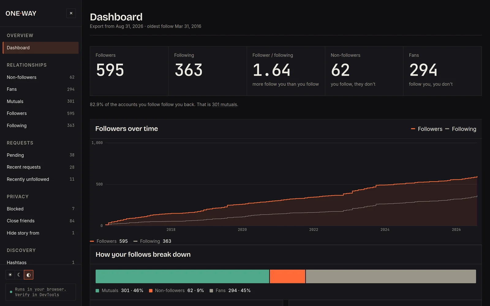
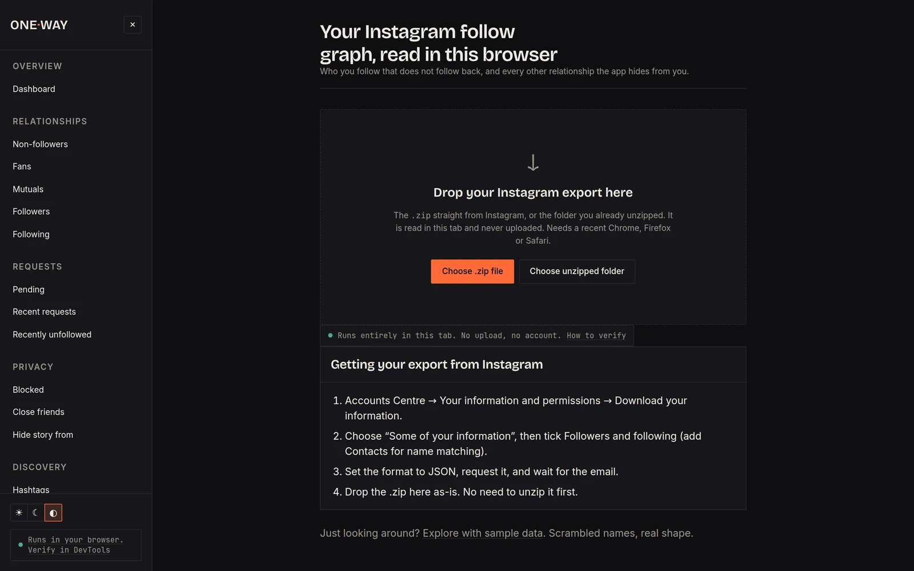
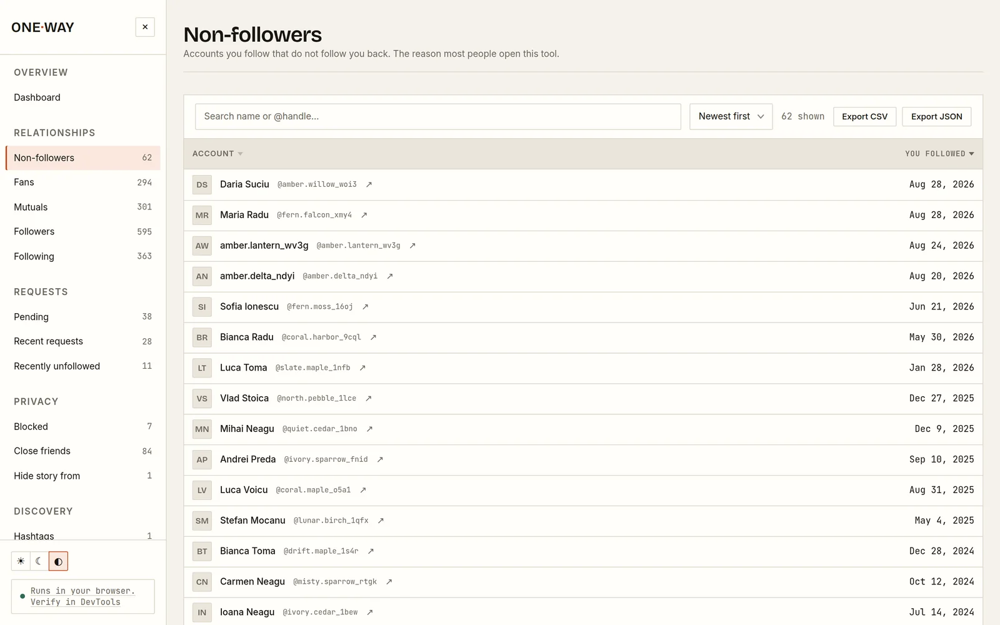
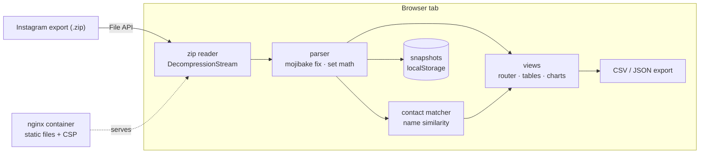

<div align="center">


<sub><a href="#-what-it-does">What it does</a> &nbsp;·&nbsp; <a href="#-privacy-enforced-by-the-browser">Privacy</a> &nbsp;·&nbsp; <a href="#-architecture">Architecture</a> &nbsp;·&nbsp; <a href="#-run-it">Run it</a> &nbsp;·&nbsp; <a href="docs/GUIDE.md">Full guide</a></sub>

</div>

<br/>

> Drop the `.zip` Instagram gives you and see who doesn't follow you back, who you don't follow back,
> pending and recent requests, recent unfollows, blocked accounts, close friends and more.
> **Nothing is uploaded.** Parsing happens entirely in the tab, and the browser itself blocks every outbound request.

<br/>



<table>
  <tr>
    <td width="50%"></td>
    <td width="50%"></td>
  </tr>
</table>

<sub>Screenshots use the built-in sample data (<code>?mock=1</code>): generated names and handles, no real accounts.</sub>

## ◆ &nbsp;What it does

<table>
  <tr>
    <td width="33%" valign="top">
      <h4>🔍 Relationships</h4>
      <p>Non-followers, fans, mutuals, followers and following, each as a searchable, sortable table with CSV and JSON export.</p>
    </td>
    <td width="33%" valign="top">
      <h4>📈 Insights</h4>
      <p>Follower-growth timeline, follow-breakdown chart, pending and recent requests, recently unfollowed, blocked, close friends, followed hashtags.</p>
    </td>
    <td width="33%" valign="top">
      <h4>🕓 Snapshots &amp; diffs</h4>
      <p>Save a parse locally and compare it with a later export to see who left, with rename detection and honest caveats.</p>
    </td>
  </tr>
  <tr>
    <td width="33%" valign="top">
      <h4>📇 Contact matching</h4>
      <p>Fuzzy name-similarity matching of phone contacts to accounts, every match labelled with a confidence level and its reasons.</p>
    </td>
    <td width="33%" valign="top">
      <h4>🌗 Polished UI</h4>
      <p>Light, dark and auto themes, keyboard-friendly tables, responsive down to phone width, self-hosted fonts.</p>
    </td>
    <td width="33%" valign="top">
      <h4>🆓 Every feature free</h4>
      <p>No account, no login, no paywall, no "pro" tier, no telemetry. A static page and an nginx container.</p>
    </td>
  </tr>
</table>

## ◆ &nbsp;Privacy, enforced by the browser

The privacy claim isn't a promise in a footer; it's a response header. nginx sends a strict
Content-Security-Policy on every response:

```
Content-Security-Policy: default-src 'self'; script-src 'self'; connect-src 'none'; ...
```

`connect-src 'none'` makes the browser refuse **every** outbound call the page could attempt:
`fetch`, `XMLHttpRequest`, WebSocket, `sendBeacon`. Even if the JavaScript tried to phone home, it couldn't.
The `.zip` is read with the browser's native `DecompressionStream`, so there is no upload endpoint
because there is nothing to upload to.

**Verify it yourself:** open DevTools → Network, clear it, load your export, and watch the list stay empty.

## ◆ &nbsp;Architecture



- **Zero build.** Plain ES modules served as static files; no bundler, no framework, no dependencies to audit.
- **Two layers with a frozen contract.** The parser (`public/src/lib`) produces one `AnalysisResult`
  ([docs/CONTRACT.md](docs/CONTRACT.md)); the UI (`public/src/state|ui|export`) only consumes it.
- **Design system as tokens.** Colours, type and spacing live in `public/styles` ([docs/DESIGN.md](docs/DESIGN.md)).
- **Hardened container.** `nginx:1.27-alpine`, read-only filesystem, dropped capabilities, healthcheck, loopback bind by default.
- **Tests in the browser.** `public/src/tests/` runs the parser and UI suites against a synthetic export.

## ◆ &nbsp;Run it

```sh
cp .env.example .env          # optional: change port / bind address
docker compose up -d --build  # nginx on 127.0.0.1:8477
```

Open <http://127.0.0.1:8477>, or <http://127.0.0.1:8477/?mock=1> to explore with sample data.
Needs Chrome/Edge 103+, Firefox 113+ or Safari 16.4+.

Getting your export, private access over Tailscale, snapshots, known limitations and the project layout are all in the
**[full guide](docs/GUIDE.md)**.

## ◆ &nbsp;Tech


<br/>

<div align="center">
<sub>Built by <a href="https://github.com/LikeMyCoffe"><b>Eduard-Florentin Enache</b></a> &nbsp;·&nbsp; Data · BI · AI product builder &nbsp;·&nbsp; MIT licensed</sub>

</div>
